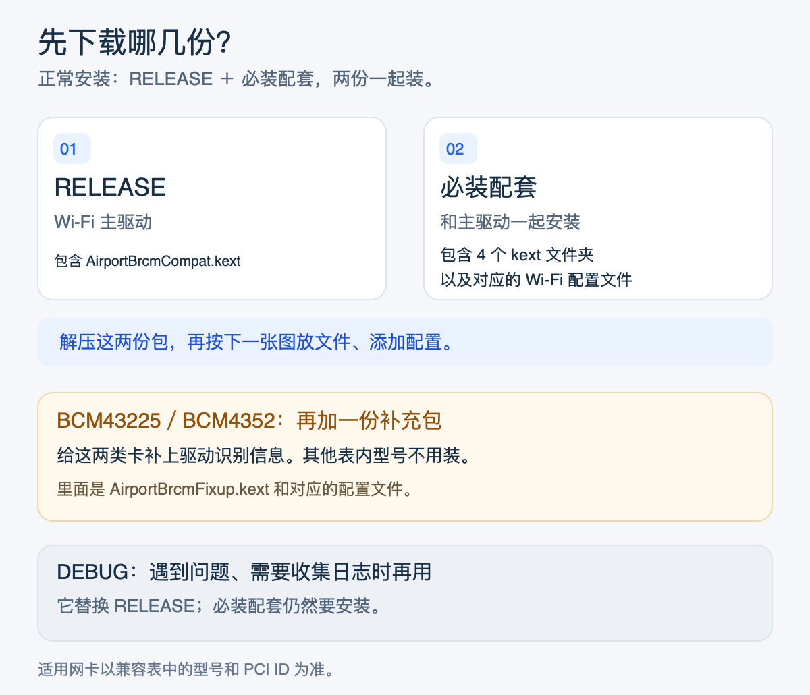
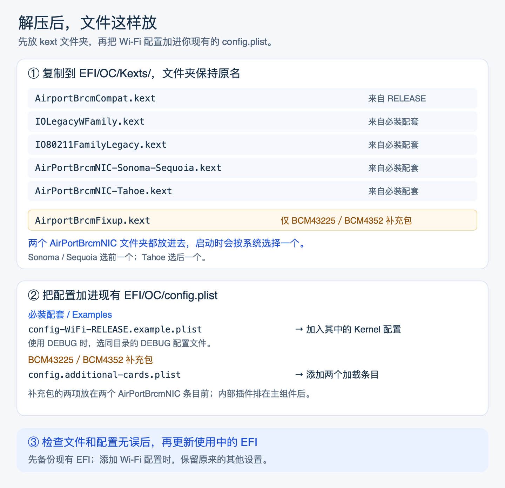
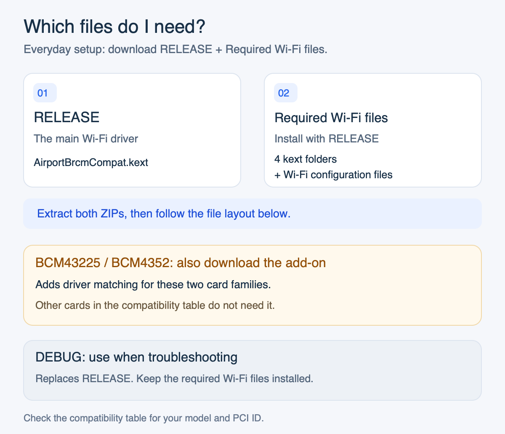
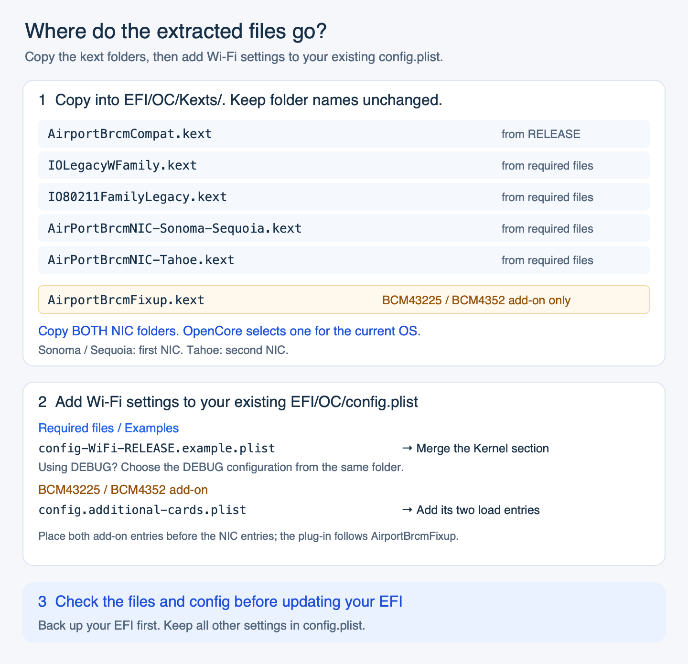

# AirportBrcmCompat

为下表中的博通网卡提供 Wi-Fi 支持，通过 EFI 加载，不修改系统卷。
**1.1.0 · Intel x86_64 · Sonoma 14 / Sequoia 15 / Tahoe 26**

[](https://github.com/GeekAudio/AirportBrcmCompat/actions/workflows/ci.yml)

## 下载

**正常安装下载 RELEASE 和「必装配套」。** BCM43225／BCM4352 再加补充包。

[01 RELEASE](https://github.com/GeekAudio/AirportBrcmCompat/releases/download/v1.1.0/01-AirportBrcmCompat-1.1.0-RELEASE.zip) · [02 必装配套](https://github.com/GeekAudio/AirportBrcmCompat/releases/download/v1.1.0/02-AirportBrcmCompat-1.1.0-WiFi-Pack.zip) · [03 BCM43225／BCM4352 补充包](https://github.com/GeekAudio/AirportBrcmCompat/releases/download/v1.1.0/03-AirportBrcmCompat-1.1.0-BCM43225-BCM4352.zip) · [04 DEBUG](https://github.com/GeekAudio/AirportBrcmCompat/releases/download/v1.1.0/04-AirportBrcmCompat-1.1.0-DEBUG.zip)



## 安装

先备份 EFI；以前打过 OCLP 无线根补丁的，先撤销该补丁。按图放文件、添加配置，保留原有的其他设置。



安装 ZIP 只放 kext 和配置文件；[校验值](https://github.com/GeekAudio/AirportBrcmCompat/releases/download/v1.1.0/05-SHA256SUMS.txt)、验证记录和版权许可在发布页单独提供。

<details>
<summary>DEBUG 排查方法（点击展开）</summary>

1. 下载 **04 DEBUG**，备份现有的 `AirportBrcmCompat.kext`，再用 DEBUG 包里的同名文件夹替换它。必装配套继续使用原来的文件。
2. 在 OpenCore 的 `boot-args` 末尾用空格追加 `-brcmcompatdbg`，保留原有参数。
3. 重启后复现问题，再打开终端执行下面两条命令。日志会保存在桌面：

```sh
sudo log show --last boot --style compact --info --debug \
  --predicate 'process == "kernel" AND eventMessage CONTAINS[c] "AirportBrcmCompat"' \
  > ~/Desktop/AirportBrcmCompat-debug.log
ioreg -r -l -w0 -c AirportBrcmCompat > ~/Desktop/AirportBrcmCompat-ioreg.log
```

反馈时提供系统版本、网卡 PCI ID 和这两份日志，分享前去掉个人信息。
排查结束后，换回 **01 RELEASE** 的同名驱动，移除 `-brcmcompatdbg` 并重启。

</details>

## 兼容表

Vendor ID 均为 `14e4`。请按 PCI ID 确认自己的网卡。

| 网卡 | PCI Device ID | Sonoma 14 | Sequoia 15 | Tahoe 26 |
| --- | --- | --- | --- | --- |
| BCM43602／BCM4350／BCM4360 | `43ba`、`43a3`、`43a0` | 离线验证 | 离线验证 | 离线验证 |
| BCM43225／BCM4352 | `4357`、`43b1`、`43b2` | 离线验证 | 离线验证 | 离线验证 |

表内表示驱动与接口的离线检查通过。BCM43602 有 1.0.1-rc1 的 Tahoe 功能基线，逐卡状态见[兼容说明](COMPATIBILITY.md)。

[配置检查工具](tools/README.md) · [构建说明](BUILDING.md) · [蓝牙作者项目](https://github.com/acidanthera/BrcmPatchRAM#bluetoolfixupkext) · [版权与来源](NOTICE.md) · [BSD-3-Clause](LICENSE)

<details>
<summary>English</summary>

AirportBrcmCompat provides Wi-Fi support for the Broadcom cards listed below through EFI/kext loading, without modifying the system volume.
**1.1.0 · Intel x86_64 · Sonoma 14 / Sequoia 15 / Tahoe 26**

### Downloads

**For everyday use, download RELEASE and Required Wi-Fi files.** BCM43225 / BCM4352 also need the add-on.

[01 RELEASE](https://github.com/GeekAudio/AirportBrcmCompat/releases/download/v1.1.0/01-AirportBrcmCompat-1.1.0-RELEASE.zip) · [02 Required Wi-Fi files](https://github.com/GeekAudio/AirportBrcmCompat/releases/download/v1.1.0/02-AirportBrcmCompat-1.1.0-WiFi-Pack.zip) · [03 BCM43225 / BCM4352 add-on](https://github.com/GeekAudio/AirportBrcmCompat/releases/download/v1.1.0/03-AirportBrcmCompat-1.1.0-BCM43225-BCM4352.zip) · [04 DEBUG](https://github.com/GeekAudio/AirportBrcmCompat/releases/download/v1.1.0/04-AirportBrcmCompat-1.1.0-DEBUG.zip)



### Installation

Back up your EFI first. Revert any existing OCLP wireless root patches. Follow the diagram to copy the files and add Wi-Fi settings to your existing configuration.



Installation ZIPs contain only kext bundles and configuration files. [Checksums](https://github.com/GeekAudio/AirportBrcmCompat/releases/download/v1.1.0/05-SHA256SUMS.txt), validation records and license notices are separate release attachments.

### Troubleshooting with DEBUG

1. Download **04 DEBUG**, back up your current `AirportBrcmCompat.kext`, then replace it with the folder from the DEBUG ZIP. Keep the required Wi-Fi files installed.
2. Append `-brcmcompatdbg` to OpenCore's existing `boot-args`, separated by a space. Keep your other arguments.
3. Restart, reproduce the issue, then run these commands in Terminal. Both files are saved to your Desktop:

```sh
sudo log show --last boot --style compact --info --debug \
  --predicate 'process == "kernel" AND eventMessage CONTAINS[c] "AirportBrcmCompat"' \
  > ~/Desktop/AirportBrcmCompat-debug.log
ioreg -r -l -w0 -c AirportBrcmCompat > ~/Desktop/AirportBrcmCompat-ioreg.log
```

When reporting an issue, include your macOS version, card PCI ID and both files. Remove personal information before sharing.
After troubleshooting, restore the driver from **01 RELEASE**, remove `-brcmcompatdbg` and restart.

### Compatibility

All PCI IDs use vendor `14e4`. Check your card's PCI ID before choosing a download.

| Cards | PCI Device IDs | Sonoma 14 | Sequoia 15 | Tahoe 26 |
| --- | --- | --- | --- | --- |
| BCM43602 / BCM4350 / BCM4360 | `43ba`, `43a3`, `43a0` | Offline checks | Offline checks | Offline checks |
| BCM43225 / BCM4352 | `4357`, `43b1`, `43b2` | Offline checks | Offline checks | Offline checks |

The table records offline driver and interface checks. BCM43602 has a historical Tahoe functional baseline from 1.0.1-rc1. See [compatibility details](COMPATIBILITY.md) for the evidence scope.

[Configuration checks](tools/README.md) · [Build instructions](BUILDING.md) · [Bluetooth upstream](https://github.com/acidanthera/BrcmPatchRAM#bluetoolfixupkext) · [Notices](NOTICE.md) · [BSD-3-Clause](LICENSE)

</details>
